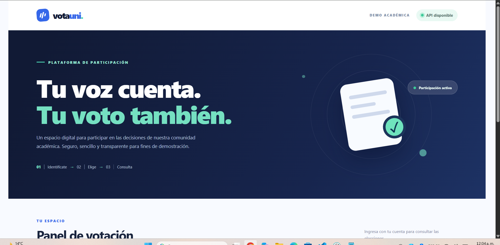
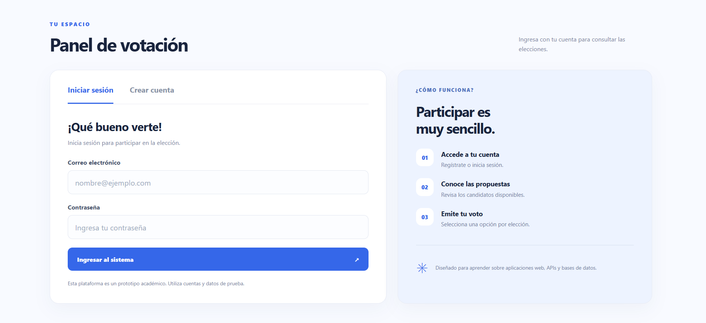
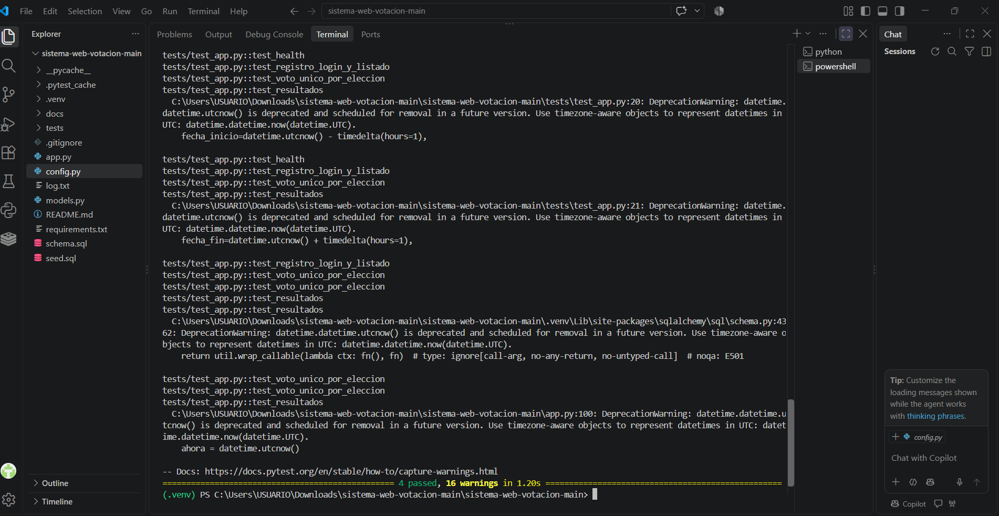
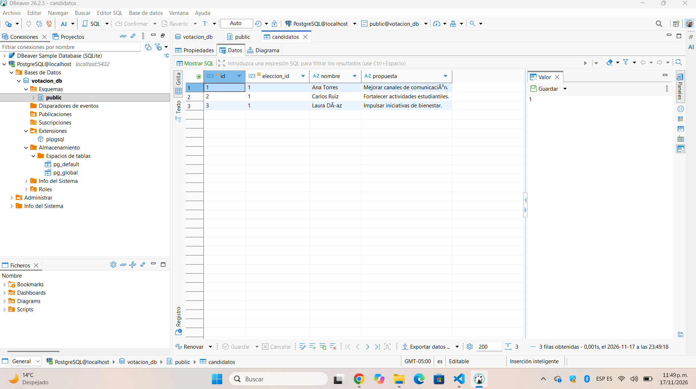

# VotaUni · Sistema Web de Votación

**Prototipo académico de votación electrónica** desarrollado para demostrar el ciclo completo de una aplicación web: registro, autenticación, consulta de elecciones, emisión de votos y visualización de resultados, con persistencia de datos en PostgreSQL.

**Autora:** Daniela Mancilla Malcue · **Modalidad:** proyecto individual  
**Asignaturas:** Estándares y Métricas de Calidad de Software / Ingeniería Web  
**Estado:** prototipo funcional en entorno local; no apto para procesos electorales reales.

## Vista previa



<details>
<summary>Ver formulario de acceso</summary>



</details>

## Funcionalidades

- Registro de usuarios e inicio y cierre de sesión.
- Consulta de elecciones y candidatos, incluyendo sus propuestas.
- Emisión de un voto por usuario y elección, con validación de duplicados.
- Consulta de resultados y conteo de votos.
- Interfaz adaptable desarrollada con HTML, CSS y JavaScript.
- API HTTP con respuestas JSON y persistencia mediante PostgreSQL.
- Pruebas automatizadas de los flujos principales.

> **Alcance académico:** el prototipo implementa controles básicos, pero no ofrece las garantías necesarias para elecciones oficiales (por ejemplo, auditoría independiente, anonimato verificable y protección frente a amenazas avanzadas).

## Tecnologías

| Capa | Tecnología |
| --- | --- |
| Interfaz | HTML5, CSS3 y JavaScript (`fetch`) |
| Backend | Python 3.13, Flask y Flask-Login |
| Persistencia | PostgreSQL 18 y Flask-SQLAlchemy / SQLAlchemy |
| Conector de PostgreSQL | psycopg2 |
| Pruebas | Pytest |
| Versionado | Git y GitHub |

## Estructura del proyecto

```text
sistema-web-votacion/
├── docs/                 # Documentación y capturas
│   └── capturas/
├── static/               # Interfaz de usuario
│   ├── ui.html
│   ├── ui.css
│   └── ui.js
├── tests/                # Pruebas automatizadas
├── app.py                # Rutas y lógica de la API Flask
├── config.py             # Configuración del proyecto
├── models.py             # Modelos de datos
├── schema.sql            # Esquema de la base de datos
├── seed.sql              # Datos de demostración
├── requirements.txt      # Dependencias de Python
├── .gitignore
└── README.md
```

## Instalación y ejecución local (Windows)

**Requisitos:** Git, Python 3.13, PostgreSQL 18 y una base de datos local. DBeaver es opcional para consultar las tablas visualmente.

**1. Clona el repositorio:**

```powershell
git clone https://github.com/DaniMancilla15/sistema-web-votacion.git
cd sistema-web-votacion
```

**2. Crea el entorno virtual e instala las dependencias:**

```powershell
python -m venv .venv
.\.venv\Scripts\python.exe -m pip install -r requirements.txt
```

**3. Prepara PostgreSQL** (solo en una base de datos nueva o vacía):

Desde `psql`, conectado como usuario con permisos de creación:

```sql
CREATE DATABASE votacion_db;
```

Luego, en PowerShell desde la raíz del proyecto, ejecuta con las herramientas de PostgreSQL disponibles en tu PATH:

```powershell
psql -h 127.0.0.1 -U postgres -d votacion_db -v ON_ERROR_STOP=1 -f .\schema.sql
psql -h 127.0.0.1 -U postgres -d votacion_db -v ON_ERROR_STOP=1 -f .\seed.sql
```

> **Atención:** `schema.sql` elimina y vuelve a crear tablas. **No lo ejecutes sobre una base con datos que quieras conservar.** `seed.sql` contiene datos iniciales de demostración.

Si `psql` no está disponible en el PATH de Windows, usa la ruta completa, por ejemplo `& "C:\Program Files\PostgreSQL\18\bin\psql.exe"` antes de sus argumentos.

**4. Configura las variables de entorno en PowerShell:**

```powershell
$cred = Get-Credential -UserName postgres -Message "Contraseña local de PostgreSQL"
$pass = $cred.GetNetworkCredential().Password
$env:DATABASE_URL = "postgresql+psycopg2://postgres:$([uri]::EscapeDataString($pass))@127.0.0.1:5432/votacion_db"
Remove-Variable pass,cred
$env:SECRET_KEY = [guid]::NewGuid().ToString('N')
```

Estas variables aplican a **esa terminal**. No subas contraseñas, archivos `.env` ni claves de sesión a GitHub. En particular, reemplaza cualquier credencial de ejemplo o clave predeterminada antes de desplegar el sistema.

**5. Inicia Flask:**

```powershell
.\.venv\Scripts\python.exe -m flask --app app run
```

Abre la interfaz desde el mismo equipo:

**http://127.0.0.1:5000/static/ui.html**

> La ruta `/` no está implementada; por eso puede mostrar `404 Not Found`. Para comprobar que la API está activa, abre `/health`.

## API HTTP

| Método | Ruta | Descripción |
| --- | --- | --- |
| `GET` | `/health` | Verifica el estado del servidor |
| `POST` | `/register` | Registra un usuario |
| `POST` | `/login` | Inicia sesión |
| `POST` | `/logout` | Cierra sesión |
| `GET` | `/elecciones` | Consulta las elecciones disponibles |
| `POST` | `/vote` | Registra un voto |
| `GET` | `/results/<eleccion_id>` | Consulta resultados de una elección |

Las operaciones protegidas requieren autenticación. La interfaz utiliza `fetch` y las cookies de sesión de Flask para comunicarse con la API en el mismo origen.

## Pruebas y evidencias

Para ejecutar las pruebas automatizadas:

```powershell
.\.venv\Scripts\python.exe -m pytest -v
```

En una ejecución local documentada se obtuvo **4 pruebas aprobadas**, con **16 advertencias de deprecación** (principalmente relacionadas con `datetime.utcnow()` y dependencias). Este resultado describe esa ejecución: debes volver a correr las pruebas después de cada cambio.

Pruebas incluidas:

1. `test_health`
2. `test_registro_login_y_listado`
3. `test_voto_unico_por_eleccion`
4. `test_resultados`



La conexión con PostgreSQL y la consulta autenticada de elecciones y resultados se comprobaron desde PowerShell. También se visualizó la tabla `candidatos` en DBeaver.



La **interfaz visual ya carga correctamente** en el navegador. Los flujos completos de registro, voto y resultados ejecutados *desde la nueva interfaz* deben verificarse nuevamente como pruebas de integración.

## Base de datos y respaldo

La base de datos utiliza las tablas `usuarios`, `elecciones`, `candidatos` y `votos`, relacionadas mediante claves y restricciones. Para una exportación de PostgreSQL se puede utilizar:

```powershell
pg_dump -h 127.0.0.1 -U postgres -d votacion_db -F c -f votacion_db.backup
```

El respaldo `.backup` **no se publica en este repositorio**. Debe entregarse por el canal definido por el docente, según las instrucciones de la asignatura. La base de demostración reconstruida con `schema.sql` y `seed.sql` no equivale necesariamente a la base histórica de otro equipo.

## Trabajo pendiente / mejoras futuras

- Validar extremo a extremo todos los flujos de la interfaz.
- Retirar credenciales y claves predeterminadas de la configuración.
- Actualizar los usos obsoletos de `datetime.utcnow()`.
- Añadir controles de seguridad, pruebas de integración y documentación para despliegue.

## Autoría y propósito

**Daniela Mancilla Malcue**  
Trabajo académico individual en el área de Ingeniería de Software.

El código se proporciona para fines formativos y de demostración. **No se recomienda utilizarlo para votaciones oficiales o públicas sin una revisión especializada de seguridad, privacidad e integridad.**
